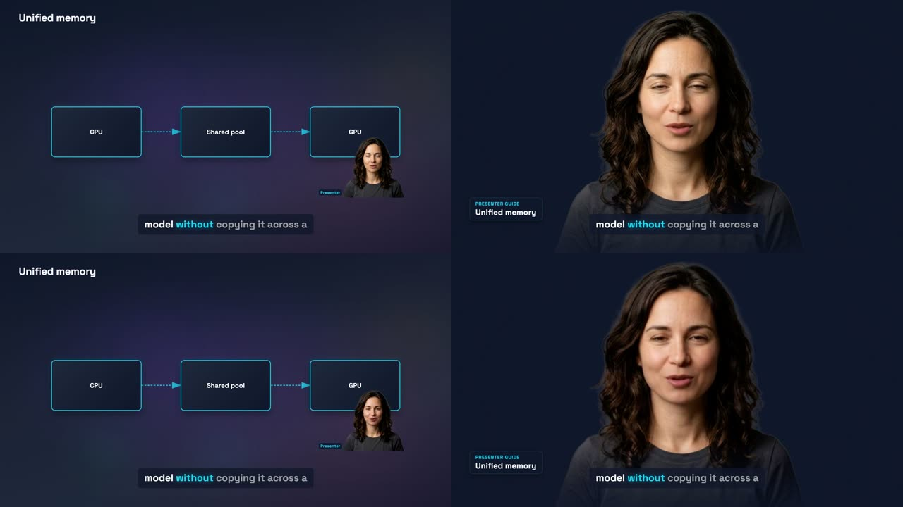

# Twin bake-off (dev) — STAND-IN — not the owner; engine validation only

Fix round 1, Group B8. Profile `standin-dev` (a fictional person generated for this test; never a real likeness). **No default engine is picked here — that is the owner's call on the real bake-off with their own identity.** Every number below was measured by `scripts/twin_bakeoff_dev.py` (each stage in its own process under `/usr/bin/time -l`).

Narration: ~23 s, stand-in Kokoro voice (`am_michael`/`am_adam` blend). Canvas 1920×1080 (16:9). Clips live in `projects/dev-twin-bakeoff/` (gitignored).

## Wall-clock and memory per stage

| Variant | Stage | Wall (s) | Peak RSS (GB) | Peak footprint (GB) | Result |
|---|---|---|---|---|---|
| (ii) hybrid: Omni idle loop + MuseTalk-MLX | lipsync | 301.4 | 5.28 | 20.33 | ok |
| (ii) hybrid: Omni idle loop + MuseTalk-MLX | matte (BiRefNet MPS) | 328.8 | 1.75 | 6.06 | ok |
| (ii) hybrid: Omni idle loop + MuseTalk-MLX | QA | 30.0 | 0.2 | 0.13 | ok |
| (ii) hybrid: Omni idle loop + MuseTalk-MLX | render PIP | 65.3 | 0.83 | 0.59 | ok |
| (ii) hybrid: Omni idle loop + MuseTalk-MLX | render full-screen | 67.9 | 0.77 | 0.59 | ok |
| (i) local: LivePortrait + MuseTalk-MLX | lipsync | 236.9 | 5.27 | 20.28 | ok |
| (i) local: LivePortrait + MuseTalk-MLX | matte (BiRefNet MPS) | 349.8 | 1.75 | 6.06 | ok |
| (i) local: LivePortrait + MuseTalk-MLX | QA | 42.3 | 0.2 | 0.13 | ok |
| (i) local: LivePortrait + MuseTalk-MLX | render PIP | 64.5 | 0.82 | 0.59 | ok |
| (i) local: LivePortrait + MuseTalk-MLX | render full-screen | 68.8 | 0.81 | 0.59 | ok |

## Quality numbers (real MediaPipe checks, QA returns real values)

| Variant | face present | mouth sync | no-raw-frames | identity | lower-face sharpness (Laplacian var, frame @8 s) |
|---|---|---|---|---|---|
| (ii) hybrid: Omni idle loop + MuseTalk-MLX | 1.0 (run) | inconclusive: offset 9 fr, peak corr 0.079 vs null p95 0.192 | not_run | fail (stand-in, by design) | 50.7 |
| (i) local: LivePortrait + MuseTalk-MLX | 1.0 (run) | inconclusive: offset 9 fr, peak corr 0.101 vs null p95 0.213 | not_run | fail (stand-in, by design) | 27.0 |

Mouth-sync note: the lip-gap vs audio-envelope proxy is weak (it did not track injected audio shifts in a control test), so the check reports `inconclusive` unless the correlation beats an unrelated-audio null; `inconclusive` never counts as a pass. Judge sync by eye/ear in the clips.

## Honesty guard

| Variant | layout | final_review | stand-in assets flagged |
|---|---|---|---|
| (ii) hybrid: Omni idle loop + MuseTalk-MLX | PIP | fail | 1 |
| (ii) hybrid: Omni idle loop + MuseTalk-MLX | full-screen | fail | 1 |
| (i) local: LivePortrait + MuseTalk-MLX | PIP | fail | 1 |
| (i) local: LivePortrait + MuseTalk-MLX | full-screen | fail | 1 |

`final_review` = `fail` for every stand-in render is the required outcome: stand-in assets can never ship. They also count as `fixture_presenter_percentage`, never `presenter_percentage` (fast test `test_standin_assets_excluded_from_presenter_percentage`).

## Paid dev calls

| Call | Estimate (USD) | Actual per API usage (USD) |
|---|---|---|
| standin portrait (gemini-3.1-flash-image, 1K) | 0.077 | not reported by the API response (estimate counted) |
| idle loop (gemini-omni-1.1-flash, 10.03 s clip) | 1.0136 | 1.0217 |

## Findings (stand-in; do not generalise to the owner's identity)

- **The alpha presenter layer works end to end**: ProRes 4444 matte → Remotion `OffthreadVideo transparent` → PIP over the diagram and full-screen over the backdrop, captions on top (contact sheet).
- **PIP vs diagram content**: with no `focus_region` on the diagram beat the bottom-right PIP overlapped the "GPU" node in both PIP renders. The layout engine can only avoid *declared* focus regions, so the scene director must set `focus_region` on every diagram beat that has a PIP (follow-up for the scene-director skill / a scene-plan validator).
- **Sharpness proxy** (single frame, lower face): the hybrid clip scored higher than the LivePortrait clip — plausible, because LivePortrait adds a second generation pass before MuseTalk's 256² crop; one frame on a fictional face is not a verdict.
- **Mouth sync is not measured by an automatic check here** (see note above) — compare the clips by eye/ear.
- **LatentSync was not run**: see `## LatentSync (B4)`.
- **Cost**: the hybrid route's only paid step is the one-time idle loop per outfit ($1.02 actual here, 47 s); everything else is local. The local route needs the owner's performance recording as the driving clip (here: the Omni idle clip, licence recorded as own generation).
- **Time per ~23 s of presenter video** (stages above): hybrid ≈ lipsync 301 s + matte 329 s; local ≈ LivePortrait 375 s (for a 10 s driving clip; scales with its length) + lipsync 237 s + matte 350 s. MLX lipsync peak footprint ≈ 20 GB (RSS 5.3 GB) — run alone under the heavy lock.

## LatentSync (B4)

**Not run — stopped at a 🛑, not a technical failure.** Weights are downloaded (`ByteDance/LatentSync-1.6`: `latentsync_unet.pt` 5 GB + `whisper/tiny.pt`, OpenRAIL++ weights / Apache-2.0 code, in the model store; the 9.6 GB repo's training/eval extras were not fetched). The only Apple-silicon route found is the MLX port `sb1992/latentsync-mlx` (Apache-2.0, 6 stars, single author), which still needs the upstream LatentSync pre-processing (decord, InsightFace detector — which must be replaced by MediaPipe, an extra integration step) and whisper in PyTorch. Converting the UNet and running that code means executing an unvetted third-party repository, and the sandbox's auto-mode classifier denied each attempt (`convert_weights.py`, even with `python -I` from outside the repo and `weights_only=True` loading). I did not work around it. **Needs the owner's explicit OK to run `sb1992/latentsync-mlx` (pinned to commit 8370f1f) in `<model store>/latentsync/venv`**, or a decision to drop LatentSync.

## Contact sheet

 — order: hybrid_mt/pip, hybrid_mt/full, local_mt/pip, local_mt/full

## Files

- `projects/dev-twin-bakeoff/hybrid_mt/` — `STANDIN_seg1.mp4` (lip-synced), `STANDIN_alpha.mov` (ProRes 4444 alpha), `qa.json`, `STANDIN_render_pip.mp4`, `STANDIN_render_full.mp4`, `final_review_*.json`
- `projects/dev-twin-bakeoff/local_mt/` — `STANDIN_seg1.mp4` (lip-synced), `STANDIN_alpha.mov` (ProRes 4444 alpha), `qa.json`, `STANDIN_render_pip.mp4`, `STANDIN_render_full.mp4`, `final_review_*.json`
